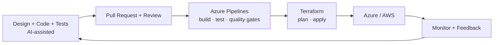

&nbsp;&nbsp;

✉️ **acevedo_0413@hotmail.com**

---

## 👋 About me

I lead a software development team working mainly with **.NET and Angular**. I care about **system design, decoupled architectures, software quality and best practices**, and I'm deeply into **cloud and DevOps**: right now I'm automating delivery with **Azure Pipelines and Terraform**.

I also work on **improving processes with AI**. I like building things that scale, and I use AI (**Claude and Codex**) as a **co-pilot, not an autopilot**: I own the design, the decisions and the quality bar, and AI helps me move faster, explore better options and learn something new every single day.

Outside of work I go low-level: bare-metal firmware, IoT mesh networks and algorithms.

<b>🇪🇸 Leer en español</b>

 

Lidero un equipo de desarrollo trabajando principalmente con **.NET y Angular**. Me importa el **diseño de sistemas, la arquitectura desacoplada, la calidad del software y las buenas prácticas**, y me apasiona **cloud y DevOps**: ahora mismo estoy automatizando despliegues con **Azure Pipelines y Terraform**.

También trabajo en **mejorar procesos con IA**. Me gusta crear cosas escalables y uso la IA (**Claude y Codex**) como **copiloto, no como piloto automático**: yo defino el diseño, las decisiones y el nivel de calidad, y la IA me ayuda a ser más rápido, explorar mejores alternativas y aprender algo nuevo todos los días.

Fuera del trabajo me meto a bajo nivel: firmware bare-metal, redes mesh IoT y algoritmos.

| | |
|---|---|
| 🔭 **Now** | CI/CD and infrastructure as code with Azure Pipelines + Terraform |
| 🧱 **Focus** | Clean architecture, decoupling, testing, quality gates |
| 🤖 **AI** | Process automation and AI-assisted engineering with Claude and Codex |
| 🌱 **Exploring** | Distributed systems, cloud architecture, embedded |

---

## 🛠️ Tech Stack

**Backend and Frontend** *(daily drivers: .NET + Angular)*

**Cloud and DevOps**

**Data and Messaging**

**Embedded and Systems**

 

---

## ⚙️ How I ship

---

## 🚀 Featured Projects

| Project | What it is | Stack |
|---|---|---|
| 🛡️ [**sentinel-os**](https://github.com/Ikeracevedo/sentinel-os) | Bare-metal OS for ESP32: custom kernel, task scheduler, memory management, synchronization, interactive shell, RAM filesystem and instrumentation. | `C` `ESP32` `RTOS` |
| 🤖 [**Nexo**](https://github.com/Ikeracevedo/Nexo) | AI agent for Microsoft Teams that centralizes commitments and tasks via Microsoft Graph, LLM processing and backend services. | `Python` `Microsoft Graph` `AI` |
| 🌾 [**Agro-Mesh**](https://github.com/Ikeracevedo/Agro-Mesh) | Agricultural IoT monitoring over a distributed ESP32 mesh (BATMAN-adv + MQTT) with environmental and soil sensors. | `C++` `ESP32` `MQTT` |
| 🌐 [**network-dashboard**](https://github.com/Ikeracevedo/network-dashboard) | Network monitoring dashboard on AWS with Docker Compose: Flask API, Nginx reverse proxy, VPC, private DNS and bastion host. | `AWS` `Docker` `Flask` `Nginx` |
| 📦 [**Logistica-Multialgoritmica**](https://github.com/Ikeracevedo/Logistica-Multialgoritmica) | Logistics optimization comparing QuickSort, MergeSort, Dijkstra, A* and Hungarian vs Greedy strategies, with performance metrics. | `Python` `Algorithms` |

> 🚧 **Coming soon:** a reference architecture with .NET + Angular + Azure Pipelines + Terraform.

---

## 📈 Activity

---

## 🧭 Engineering principles

- **Decouple first** — boundaries, interfaces and dependency inversion over clever shortcuts.
- **Quality is built in** — tests, code review, static analysis and quality gates in the pipeline.
- **Everything as code** — infrastructure, pipelines and environments are versioned and reproducible.
- **AI as a multiplier** — it amplifies my judgment; it never replaces it.

