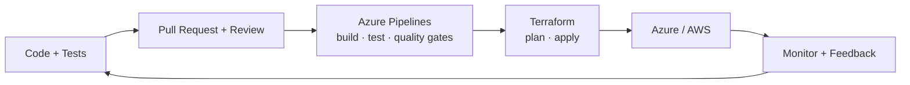

---

## 👋 About me / Sobre mí

🇬🇧 **EN** — I lead a software development team working mainly with **.NET and Angular**. I care about **system design, decoupled architectures, software quality and best practices**, and I'm deeply into **cloud and DevOps**: right now I'm automating delivery with **Azure Pipelines and Terraform**. Outside of work I go low-level: bare-metal firmware, IoT mesh networks and algorithms.

🇪🇸 **ES** — Lidero un equipo de desarrollo trabajando principalmente con **.NET y Angular**. Me importa el **diseño de sistemas, la arquitectura desacoplada, la calidad del software y las buenas prácticas**, y me apasiona **cloud y DevOps**: ahora mismo estoy automatizando despliegues con **Azure Pipelines y Terraform**. Fuera del trabajo me meto a bajo nivel: firmware bare-metal, redes mesh IoT y algoritmos.

- 🔭 Currently / Actualmente: automating CI/CD & infrastructure as code (Azure + Terraform)
- 🧱 Focus / Enfoque: clean architecture, SOLID, decoupling, testing, quality gates
- 🌱 Exploring / Explorando: AI agents, distributed systems, embedded
- 📫 Contact / Contacto: [Email](mailto:ikeracevedowrk@gmail.com)

---

## 🛠️ Tech Stack

**Backend & Frontend** — *daily drivers: .NET + Angular*

**Cloud & DevOps**

**Data**

**Embedded & Systems**

---

## ⚙️ How I ship / Cómo entrego

---

## 🚀 Featured Projects / Proyectos destacados

| Project | What it is / Qué es | Stack |
|---|---|---|
| 🛡️ [**sentinel-os**](https://github.com/Ikeracevedo/sentinel-os) | Bare-metal OS for ESP32: custom kernel, task scheduler, memory management, synchronization, interactive shell, RAM filesystem and instrumentation. | `C` `ESP32` `RTOS` |
| 🤖 [**Nexo**](https://github.com/Ikeracevedo/Nexo) | AI agent for Microsoft Teams that centralizes commitments and tasks via Microsoft Graph, LLM processing and backend services. | `Python` `Microsoft Graph` `AI` |
| 🌾 [**Agro-Mesh**](https://github.com/Ikeracevedo/Agro-Mesh) | Agricultural IoT monitoring over a distributed ESP32 mesh (BATMAN-adv + MQTT) with environmental and soil sensors. | `C++` `ESP32` `MQTT` |
| 🌐 [**network-dashboard**](https://github.com/Ikeracevedo/network-dashboard) | Network monitoring dashboard on AWS with Docker Compose: Flask API, Nginx reverse proxy, VPC, private DNS and bastion host. | `AWS` `Docker` `Flask` `Nginx` |
| 📦 [**Logistica-Multialgoritmica**](https://github.com/Ikeracevedo/Logistica-Multialgoritmica) | Logistics optimization comparing QuickSort, MergeSort, Dijkstra, A* and Hungarian vs Greedy strategies, with time/performance metrics. | `Python` `Algorithms` |

---

## 📊 GitHub Stats

---

## 🧭 Engineering principles / Principios

- **Decouple first** — boundaries, interfaces and dependency inversion over clever shortcuts.
- **Quality is built in** — tests, code review, static analysis and quality gates in the pipeline.
- **Everything as code** — infrastructure, pipelines and environments are versioned and reproducible.
- **Simple > clever** — complex systems made of simple, observable parts.

